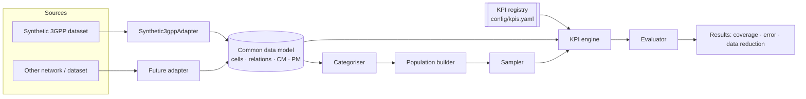

# Final Year Project: Network KPI Sampling

**Cell categorisation and sampling-based KPI estimation for mobile networks**

Final Year Project, BSc (Hons) Software Design in AI with Cloud Computing.
Student: Roy Cheong · Supervisor: Peter Vargovcik · Industry partner: Ericsson

## Overview

Mobile operators measure network efficiency through Key Performance Indicators (KPIs) calculated from Performance Management (PM) counters reported by every cell. This project tests whether those KPIs can be estimated accurately by **sampling** part of the network instead of measuring all of it, in the same way an opinion poll samples a population.

**Research question:** can KPIs calculated from a sample of a categorised network population be shown to be as accurate as KPIs calculated from the entire network, within a chosen confidence level and margin of error?

The pipeline:

1. **Categorise** nodes and cells from Configuration Management (CM) data.
2. **Build populations** (strata) from those categories.
3. **Sample** each population at a chosen confidence level (e.g. 95%) and margin of error (e.g. ±3%).
4. **Calculate 3GPP KPIs** from PM data for the sample and for the entire network.
5. **Evaluate** how often the sample lands within the stated margin of the full-network value.

## Architecture

The system is a modular pipeline. Each stage sits behind a defined interface and communicates through a common data model, so any dataset of the same type can be plugged in by writing one new adapter.



| Module | File | Responsibility | Status |
| --- | --- | --- | --- |
| Data adapter interface | `src/kpisampling/adapters/base.py` | Contract every data source implements | Done |
| Synthetic 3GPP adapter | `src/kpisampling/adapters/synthetic_3gpp.py` | Loads the synthetic 4G + 5G dataset into the common model | In progress |
| Common data model | `src/kpisampling/model.py` | Table definitions and validation | Done |
| Categoriser | `src/kpisampling/categorise.py` | Assigns nodes/cells to categories from CM data | Planned |
| Population builder | `src/kpisampling/populations.py` | Turns categories into sampling populations | Planned |
| Sampler | `src/kpisampling/sampling.py` | Sample-size calculation (Cochran + finite population correction), random sampling | Partly done |
| KPI engine + registry | `src/kpisampling/kpi.py`, `config/kpis.yaml` | 3GPP KPI formulae stored as configuration | In progress |
| Evaluator | `src/kpisampling/evaluate.py` | Compares sampled vs full-network KPIs | Planned |

**Design decisions**

- **Adapters + common data model:** downstream modules never read raw files, so changing the dataset does not change the analysis code.
- **KPI registry as configuration:** adding a 3GPP KPI or a vendor counter mapping is a YAML change, not a code change.
- **Ground truth kept separate:** `entity_labels.json` is used only to validate categorisation, never as its input.

## Dataset

The project uses a synthetic 4G + 5G network dataset (3GPP Release 19 names, 30 days, 15-minute ROPs, 60 cells). It contains no operator or subscriber data. **The dataset is not included in this repository.** See [`data/README.md`](data/README.md) for where to place it.

## Getting started

```bash
python -m venv .venv
# Windows: .venv\Scripts\activate    macOS/Linux: source .venv/bin/activate
pip install -e ".[dev]"

cp config/settings.example.yaml config/settings.yaml
python scripts/convert_pm_to_parquet.py     # once, after placing the dataset
pytest
```

## Project structure

```
config/                 settings template and KPI registry
data/                   dataset location (git-ignored)
notebooks/              exploration and experiments
scripts/                one-off data preparation
src/kpisampling/        the pipeline package
tests/                  unit tests
```

## Development workflow

- `main` holds stable, demo-ready versions only.
- `dev` is the integration branch.
- Each piece of work is done on a `feature/<name>` branch and merged into `dev` through a pull request.

## Known limitations

- The baseline dataset has 60 cells, which is too small for cell-level sampling to save data (95% / ±3% needs 57 of 60 cells). Options under consideration: a larger generated network, or sampling cell × time units.
- Every node has 3 cells, so cells-per-node cannot be used as a category in this dataset.
- Indoor/outdoor, overlay, standard mode and region are generator labels, not 3GPP CM attributes.

## Roadmap

| Milestone | Date |
| --- | --- |
| Demo 1: architecture, adapter, sample-size calculator | November/December 2026 |
| Technical presentation and Demo 2: end-to-end MVP | Week of 1 February 2027 |
| Research paper | Before 5 April 2027 |
| Final demo | Week of 5 April 2027 |

## References

- Cochran, W.G. (1977) *Sampling Techniques*, 3rd edn. Wiley.
- Lohr, S.L. (2021) *Sampling: Design and Analysis*, 3rd edn. CRC Press.
- 3GPP TS 28.552 (5G performance measurements), TS 28.554 (5G end-to-end KPIs), TS 32.425 / TS 32.450 (LTE measurements and KPIs).
